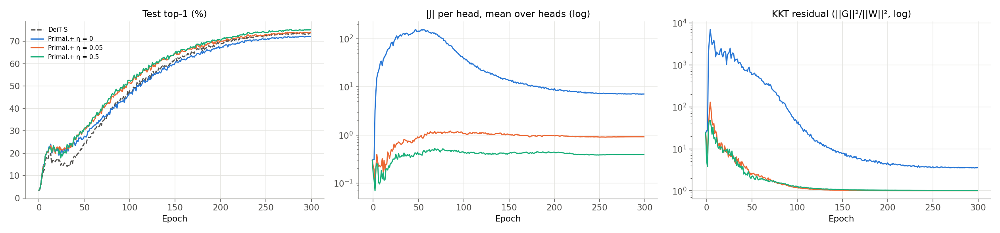
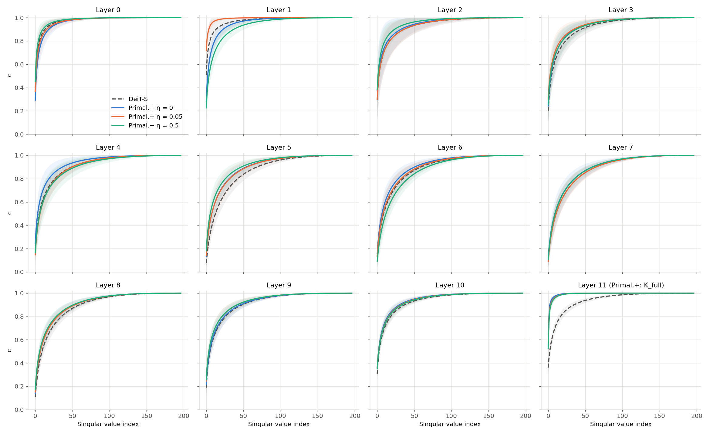

# How the KSVD regularizer η shapes Primal-Attention

Ablation experiments on **Primal-Attention** (Chen, Tao, Tonin and Suykens, *Primal-Attention: Self-attention through
Asymmetric Kernel SVD in Primal Representation*, NeurIPS 2023). The model code in the parent folders is the authors'
([yingyichen-cyy/PrimalAttention](https://github.com/yingyichen-cyy/PrimalAttention)) and is used unchanged. Everything in
this `analysis/` folder (experiment design, diagnostics, cluster jobs, results) is my own work.

Primal-Attention replaces softmax attention with a kernel-SVD (KSVD) formulation and adds a regularizer `η · J²` to the
training loss, where `J` is the KSVD objective. The paper motivates it with Figure 1: the attention of Primal.+ models is
claimed to have a sharper (lower-rank) singular-value spectrum. These experiments vary only η and ask what the regularizer
actually changes: accuracy, the spectrum, and whether the KSVD optimality conditions are met.

## Experiments

| Folder | Status | Setting |
|---|---|---|
| [imagenet_eta_ablation/](imagenet_eta_ablation/) | finished. Report: [REPORT.md](imagenet_eta_ablation/REPORT.md) | Primal.+DeiT-Small/16 on ImageNet-100, η ∈ {0, 0.05, 0.5}, plus a DeiT-Small/16 baseline, 300 epochs each on 4× H100 (VSC wICE cluster) |
| [timeseries_eta_ablation/](timeseries_eta_ablation/) | finished | Primal.+Trans. on UWaveGestureLibrary, η ∈ {0, 0.1, 0.2, 0.5} × 3 seeds. Report: [REPORT.md](timeseries_eta_ablation/REPORT.md) |

## ImageNet-100 results

The paper's training recipe (300 epochs, total batch 1024, DeiT augmentation and schedule), one seed per setting.
Top-1 accuracy on the 5,000 validation images:

| Model | η | Final epoch | Best epoch | Paper (Table 7a) |
|---|---|---|---|---|
| DeiT-Small/16 | – | 73.48 | 73.66 | 74.2 |
| Primal.+DeiT-Small/16 | 0 | 72.08 | 72.20 | – |
| Primal.+DeiT-Small/16 | 0.05 (paper's value) | 73.96 | 74.04 | 75.7 |
| Primal.+DeiT-Small/16 | 0.5 | **75.12** | **75.18** | – |

- **Accuracy rises with η** (72.1 → 74.0 → 75.1). Without the regularizer (η = 0), the Primal model is 1.4 points
  *below* the softmax baseline, so the gain comes from the KSVD term in the loss rather than from the architecture.
- **The paper's ranking reproduces** (Primal.+ at η = 0.05 above DeiT-S), with a smaller margin: 0.5 points against the
  paper's 1.5. Both of our models sit 0.7–1.7 points below the paper. Likely contributors: an unofficial ImageNet-100 copy
  (same 100 classes and image counts), H100 with PyTorch 2.4 instead of V100 with PyTorch 1.7, and a single seed.
- **How the regularizer is satisfied** (from the per-head diagnostics logged during training, final epoch). With η > 0,
  the squared head-mean `J²` that the loss penalizes falls to about 5 × 10⁻⁵, but the individual heads keep |J| of
  0.03–1.5 *with opposite signs*, so they cancel in the mean. At the same time 29–59 of each head's 96 Λ values collapse
  below 10⁻³, and the KKT residual stays at about 1 rather than approaching 0. So the KSVD objective is driven to zero
  without reaching a stationary point of KSVD. The time-series experiment showed the same pattern.

*Left: test top-1 per epoch. Middle: mean |J| per head on 32 fixed validation images. Right: KKT residual
`(‖G_e‖² + ‖G_r‖²) / (‖W_e‖² + ‖W_r‖²)`. Single seed per curve.*

- **The spectrum: sharp, but not because of η.** The Primal layer's kernel is far more concentrated than softmax
  attention, as in the paper's Figure 1(c): 90% of its singular-value mass sits in 3–4 values against 35 for DeiT-S's last
  layer (effective rank 4–5 against 22). But it is sharpest at **η = 0**, with no regularizer, and gets slightly flatter as
  η grows (effective rank 3.9 → 4.5 → 5.0). The sharpness comes from the kernel form itself: a softmax built from the
  same layer's q and k is *flatter* than DeiT's. The softmax layers 0–10 show no consistent η effect.

*Normalized cumulative singular value per layer (mean over 1,000 validation images and 6 heads, ± std shaded). Layer 11 of
the Primal.+ models is the Primal kernel.*

**Caveats:** one seed per setting (seed-to-seed spread on ImageNet-100 is typically a few tenths of a point), ImageNet-100
rather than the ImageNet-1K of the paper's Figure 1, and final-epoch checkpoints throughout.

## What is in `imagenet_eta_ablation/`

| File | Purpose |
|---|---|
| [PLAN.md](imagenet_eta_ablation/PLAN.md) | Experimental design, measurement protocol, deviations from the paper, compute budget |
| [RECON_REPORT.md](imagenet_eta_ablation/RECON_REPORT.md) | What the paper states versus what the code does, with file and line references |
| [RUNBOOK.md](imagenet_eta_ablation/RUNBOOK.md) | Step-by-step commands for the cluster, with the progress log (job IDs, costs) |
| `train_with_j_log.py` | Wraps the authors' training script unchanged and logs per-head `J`, KKT residuals and Λ every epoch |
| `check_j_logger.py` | Checks those diagnostics against the repository's own `J` and against autograd |
| `figure1_spectra.py`, `figure1_plots.py` | Float64 singular-value spectra of every attention matrix (four candidate matrices for the Primal layer), and the figures |
| `convert_imagenet100.py` | Converts the Hugging Face ImageNet-100 parquet files to the ImageFolder layout, byte-identical images |
| `check_env.py`, `local_test.sh` | Environment and end-to-end checks before spending cluster credits |
| `jobs/` | Slurm scripts for VSC wICE (training with automatic resume, spectra) |
| `results/raw_logs/` | Per-epoch `log.txt` and `J_log.csv` of every run |

Datasets and checkpoints are not in the repository (git-ignored).
