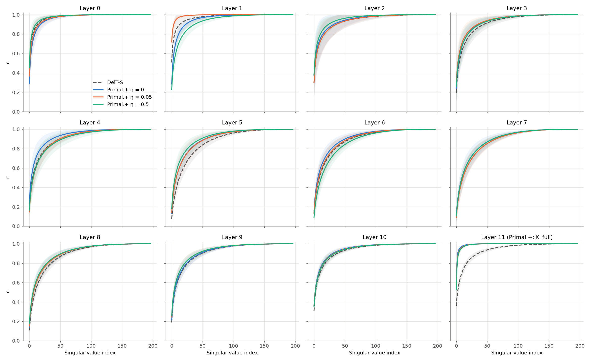
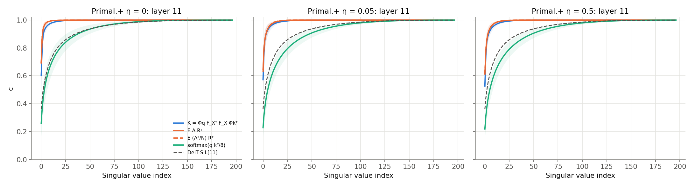
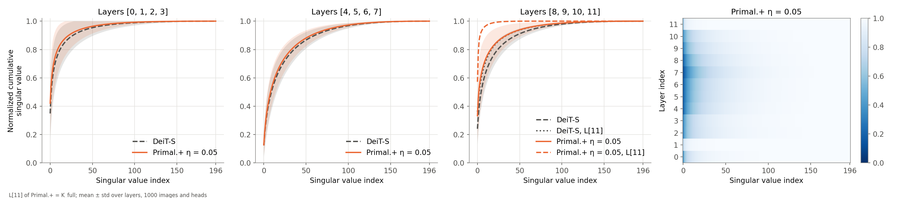
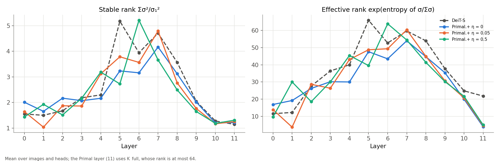
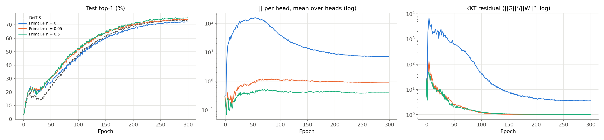

# Does η sharpen the attention spectrum of Primal.+DeiT-Small/16? (ImageNet-100)

Four models trained from scratch with the paper's recipe (300 epochs, total batch 1024, 4× H100 on VSC wICE), one seed
each: Primal.+DeiT-Small/16 at η ∈ {0, 0.05, 0.5} and a DeiT-Small/16 baseline. Spectra use each run's final-epoch
checkpoint on the same 1,000 validation images (the first 10 files of each class), every layer and head, float64 SVD.
Design and deviations from the paper: [PLAN.md](PLAN.md). Commands, job IDs and costs: [RUNBOOK.md](RUNBOOK.md).

## Answer

**The Primal layer's spectrum is very sharp, as in the paper's Figure 1(c), but η is not what makes it sharp.** At η = 0,
with no KSVD term in the loss, the Primal kernel is already the sharpest. Increasing η makes it slightly *flatter*, in the
same direction as the time-series experiment. The sharpness comes from the layer's form (a rank-≤64 kernel), not from the
regularizer. η does raise accuracy, so the regularizer helps through some other mechanism.

## 1. Accuracy

| Model | η | Final top-1 | Best top-1 (epoch) | Paper (Table 7a) |
|---|---|---|---|---|
| DeiT-S | – | 73.48 | 73.66 (282) | 74.2 |
| Primal.+ | 0 | 72.08 | 72.20 (294) | – |
| Primal.+ | 0.05 | 73.96 | 74.04 (274) | 75.7 |
| Primal.+ | 0.5 | 75.12 | 75.18 (277) | – |

Accuracy rises with η. Without the regularizer the Primal model is 1.4 points below DeiT-S. The paper's ranking at
η = 0.05 reproduces with a smaller margin (0.5 against 1.5 points), and both models sit 0.7–1.7 points below the paper.

## 2. The Primal layer (layer 11)

The kernel `K = Φ_q F_Xᵀ F_X Φ_kᵀ`, compared with the softmax of DeiT-S at the same layer. ± is the spread over images and
heads, not over seeds.

| Model | σ₁ / Σσ | Values for 90% of Σσ | for 99% | Effective rank | Stable rank |
|---|---|---|---|---|---|
| DeiT-S, softmax | 0.36 | 35 | 112 | 21.8 ± 4.9 | 1.15 |
| Primal.+ η = 0 | **0.60** | **3** | **17** | **3.9 ± 1.1** | 1.22 |
| Primal.+ η = 0.05 | 0.57 | 4 | 21 | 4.5 ± 1.6 | 1.26 |
| Primal.+ η = 0.5 | 0.53 | 4 | 22 | 5.0 ± 1.3 | 1.31 |

- **The kernel is about 5× more concentrated than DeiT's softmax.** 90% of the singular-value mass sits in 3–4 values,
  against 35 for DeiT. This is the dashed Primal.+ L[11] curve of the paper's Figure 1(c), which reaches 1 within a few
  indices.
- **Every η-trend points away from sharpening.** σ₁/Σσ falls (0.60 → 0.57 → 0.53) and effective rank rises
  (3.9 → 4.5 → 5.0) as η grows. With one seed per η the size of the trend is uncertain, but there is no sign that η sharpens
  the spectrum. The time-series ablation (3 seeds) found the same direction: effective rank 1.97 → 2.37 from η = 0 to 0.5.
- **K has rank exactly 64 on every image** (the head dimension p = 64 bounds it), but its effective rank of about 4 is far
  below that bound. So the low rank is not only the algebraic limit: the learned features concentrate further.

*One panel per layer: mean normalized cumulative singular value over 1,000 images and 6 heads, ± std shaded. Layer 11 of
the Primal.+ models is the kernel K.*

### Which matrix does the paper plot?

The kernel K and both s-direction reconstructions (`E Λ Rᵀ` and the code-consistent `E (Λ²/N) Rᵀ`) are nearly identical
and all sharp. A softmax built from the Primal layer's *own* q and k, `softmax(q kᵀ/8)`, is flatter than DeiT's
(effective rank 29–37 against 22). So the learned q and k are not special; the sharp curve comes from replacing softmax
with the kernel form. The paper's L[11] curve matches K or its reconstruction, not a softmax.

## 3. The softmax layers (0–10)

There is no consistent η effect. Differences between runs are as large at η = 0 as between η values, so most of them are
training randomness. Layer 1 is the extreme case: its effective rank is 3.7 at η = 0.05, 19.2 at η = 0 and 30.0 at
η = 0.5. Averaged over layers 0–10, the Primal.+ models are slightly more concentrated than DeiT-S (effective rank 33–35
against 38), in line with the paper's panels (a) and (b), where the Primal.+ curves sit slightly above DeiT's.

*The paper's layout for η = 0.05 against our DeiT-S. Layouts for the other η, and σ²-based versions (`_c2`), are in
[figures/](figures/).*

## 4. What η does to the KSVD objective

Final-epoch values from `results/raw_logs/*/J_log.csv` (32 fixed validation images):

| η | Per-head J | (mean J)², what the loss penalizes | Λ values below 10⁻³, per head (of 96) | KKT residual |
|---|---|---|---|---|
| 0 | 5.6 to 9.0 | 50.3 | 0–1 | 2.5–5.4 |
| 0.05 | −1.48 to +1.19 | 4.9 × 10⁻⁵ | 33–59 | 1.00–1.01 |
| 0.5 | −0.69 to +0.56 | 3.4 × 10⁻⁵ | 29–40 | 1.01–1.04 |

The loss penalizes the square of J averaged over heads (and batch and tokens). With η > 0 that average is driven to
almost 0, but **the heads do not individually reach J = 0: they take opposite signs and cancel.** At the same time a third
to over half of the Λ entries collapse to about 0. A residual of exactly about 1 is what this collapse predicts: with the
Λ²-weighted terms gone, `G_e ≈ −W_r` and `G_r ≈ −W_e`. So the regularizer is satisfied without reaching a stationary point
of KSVD. The time-series ablation showed the same pattern.

## Caveats

- **One seed per setting.** The η trends in sections 2 and 4 are consistent in direction (and with the 3-seed time-series
  result), but their size has no seed error bar. Two extra seeds at η = 0 and 0.5 would cost about 0.5M credits.
- **ImageNet-100, not ImageNet-1K.** The paper's Figure 1 uses ImageNet-1K models. Our curves can be compared in shape,
  not value for value. The calibration step (official DeiT-S on the ImageNet-1K validation set) was not run, so the
  choice of σ (not σ²) for the main figures follows the paper's axis label rather than a measured match.
- **Final-epoch checkpoints** throughout, and the regular (non-EMA) weights, as in the repository's evaluation.

## Cost

| Job | GPU | Time | Credits |
|---|---|---|---|
| η = 0.05 (62653792) | 4× H100 | 1 h 40 min | 250,316 |
| η = 0 (62663183) | 4× H100 | 1 h 47 min | 266,726 |
| η = 0.5 (62663184) | 4× H100 | 1 h 45 min | 262,644 |
| DeiT-S (62663186) | 4× H100 | 1 h 43 min | 256,688 |
| Spectra (62689649) | 1× V100 | about 1 h 50 min | small (V100) |

Spectra summary table: [results/spectra_summary.csv](results/spectra_summary.csv). Reproduce the figures with
`figure1_plots.py` (see RUNBOOK step 17).
