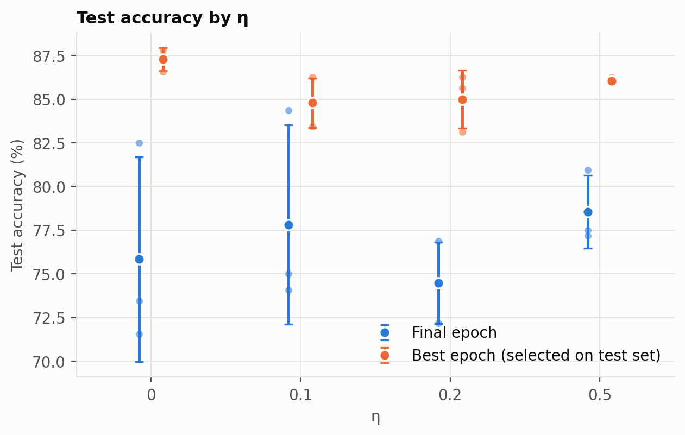
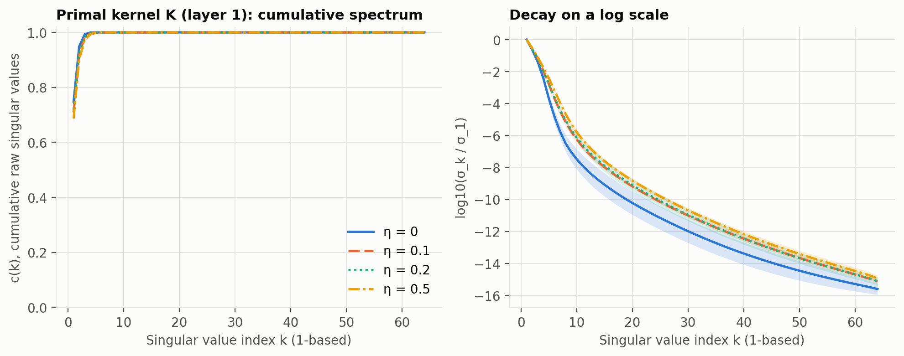
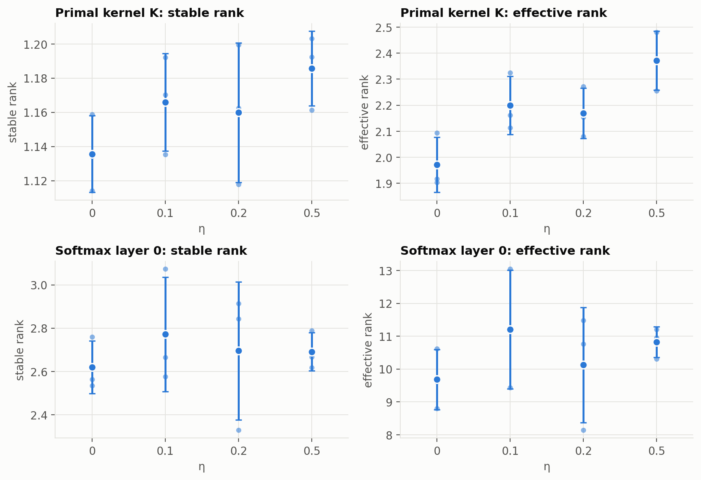
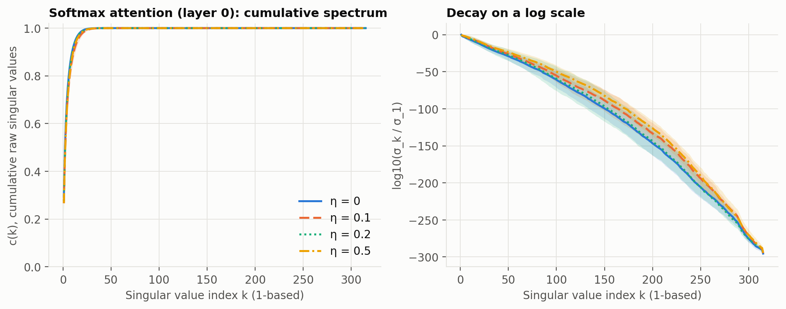
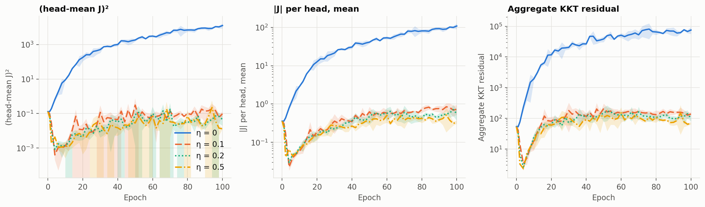
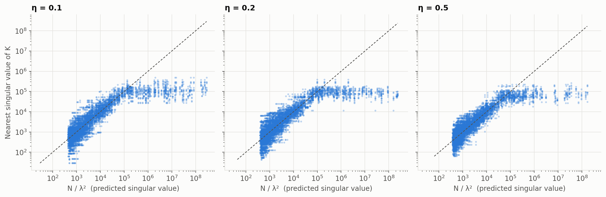
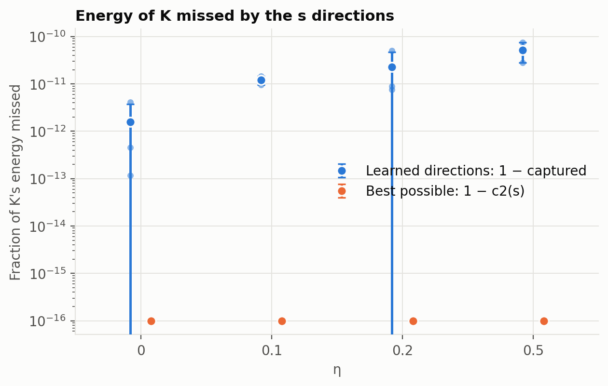

# Does η sharpen the attention spectrum in Primal.+Trans?

UWaveGestureLibrary, 12 runs: η ∈ {0, 0.1, 0.2, 0.5} × seeds {1, 2, 3}, 100 epochs, s = 40, data-dependent weights. All
spectra use each run's **final-epoch** checkpoint on the same 128 test sequences. ± is one standard deviation over 3 seeds.
Code and paper differences are in `PHASE1_REPORT.md`.

## Answer

**With these settings, η did not sharpen the spectrum of the Primal kernel K. If anything, η > 0 made it slightly flatter.**

- Effective rank of K rose from 1.97 ± 0.11 at η = 0 to 2.37 ± 0.11 at η = 0.5. Stable rank moved the same way, but its gaps are
  within about two seed standard deviations, and the rise is not monotonic in η.
- On the softmax layer 0, all differences are within seed-to-seed spread, so there is no clear effect.
- The regularizer clearly drives `J` toward 0, but the KKT residuals stay large. This is direct evidence that `J` near 0 is reached
  without stationarity.

With 3 seeds this is an indication, not a firm estimate. It also applies to one dataset and one model. It does not test the paper's
Figure 1 directly, which is DeiT-Small/16 on ImageNet-1K. The paper's layer "L[11]" is the last of 12 DeiT layers; **the Primal layer here is layer 1**, the
last of 2.

## Accuracy, time and memory

| η | Final test accuracy (%) | Best test accuracy (%) | s/epoch | Minutes/run | Peak memory (MiB) |
|---|---|---|---:|---:|---:|
| 0 | 75.8 ± 5.8 | 87.3 ± 0.7 | 3.0 | 8.3 | 807 |
| 0.1 | 77.8 ± 5.7 | 84.8 ± 1.4 | 3.0 | 8.2 | 807 |
| 0.2 | 74.5 ± 2.3 | 85.0 ± 1.7 | 3.0 | 8.2 | 807 |
| 0.5 | 78.5 ± 2.1 | 86.0 ± 0.2 | 3.0 | 8.2 | 807 |

Final accuracy shows no clear η effect. "Best" is chosen on the test set, which is the repo's metric (the paper reports 88.4% for
this dataset), and it runs about 7 to 12 points above final accuracy. The best epoch was often very early (epoch 2 in 5 of 12 runs).

## Primal kernel K (layer 1)

| Metric | η = 0 | η = 0.1 | η = 0.2 | η = 0.5 |
|---|---|---|---|---|
| Stable rank | 1.136 ± 0.022 | 1.166 ± 0.029 | 1.160 ± 0.041 | 1.186 ± 0.022 |
| Effective rank | 1.971 ± 0.106 | 2.200 ± 0.111 | 2.169 ± 0.096 | 2.371 ± 0.113 |
| σ₁ | 5.42e5 ± 5.9e4 | 1.16e5 ± 1.7e4 | 9.22e4 ± 1.7e3 | 7.34e4 ± 4.8e3 |

The linear `c(k)` curve cannot separate the η values: K's spectrum is so steep that every curve reaches about 1 within a few indices. The log-scale panel shows
η = 0 decaying fastest, though its seed band is wide, and it overlaps the other curves at some indices. σ₁ falls sharply once η > 0,
so the regularizer changes the kernel's scale far more than its shape. Stable and effective rank do not depend on scale.

## Softmax attention (layer 0)

| Metric | η = 0 | η = 0.1 | η = 0.2 | η = 0.5 |
|---|---|---|---|---|
| Stable rank | 2.62 ± 0.12 | 2.77 ± 0.27 | 2.70 ± 0.32 | 2.69 ± 0.09 |
| Effective rank | 9.68 ± 0.91 | 11.21 ± 1.80 | 10.13 ± 1.75 | 10.82 ± 0.46 |

## Are the learned directions KSVD solutions?

Values at epoch 100 on the 32 fixed diagnostic sequences. `|J|` is averaged per head, before the head-mean that the loss squares.

| Metric | η = 0 | η = 0.1 | η = 0.2 | η = 0.5 |
|---|---|---|---|---|
| (head-mean J)² | 1.27e4 | 0.097 | 0.046 | 0.013 |
| Mean \|J\| per head | 109 | 0.73 | 0.55 | 0.34 |
| Aggregate residual | 7.55e4 | 139 | 100 | 69 |
| Median `ρ_l` | 1.07e4 | 19.0 | 17.2 | 19.2 |

- η > 0 reduces `J²` by about 5 to 6 orders of magnitude, and residuals by about 3, compared with η = 0.
- Residuals remain far above zero: an aggregate of 69 to 139 means the stationarity error is roughly 8 to 12 times the size of `W`.
  Some of this is structural, because `W_e`, `W_r` and `Λ` are shared across sequences while `F_X` changes with each one.
- Per-head `|J|` is larger than the size of the head-mean, so heads partly cancel in the penalty.

### `N/λ²` against the singular values of K

For η > 0, `N/λ²` matches its nearest singular value only loosely: median relative error 0.54, 0.51 and 0.45 for η = 0.1, 0.2 and 0.5.
Near-zero `|λ|` values (below 1e-3) averaged 4.8, 3.3 and 2.4 of 40 per head and are excluded. η = 0 leaves `Λ` untrained, so it is not interpreted.

### Captured energy

`captured` and `c2(s)` are both effectively 1 for every η, because almost all of K's energy is in its first few directions. This metric therefore does not
distinguish the η values here.

## Limits

- 3 seeds per η, one dataset, and a strongly overfitting setup (final accuracy well below best).
- Results describe the final-epoch model, not the best-epoch one.
- The paper has no code showing which Primal-layer matrix Figure 1 decomposed, so this tests the full implicit kernel K from the brief.
- The spread over `F_X` samplings is not applicable: `F_X` is deterministic, and on UWave `n = N`.
- `rank_1e-14` (45 to 53 on average, at most 64) is close to machine precision and should not be read as a measured rank.
- The chart palette's validator could not be run here (`node` is not installed). Colours come from the documented palette, and η also has distinct line styles.
